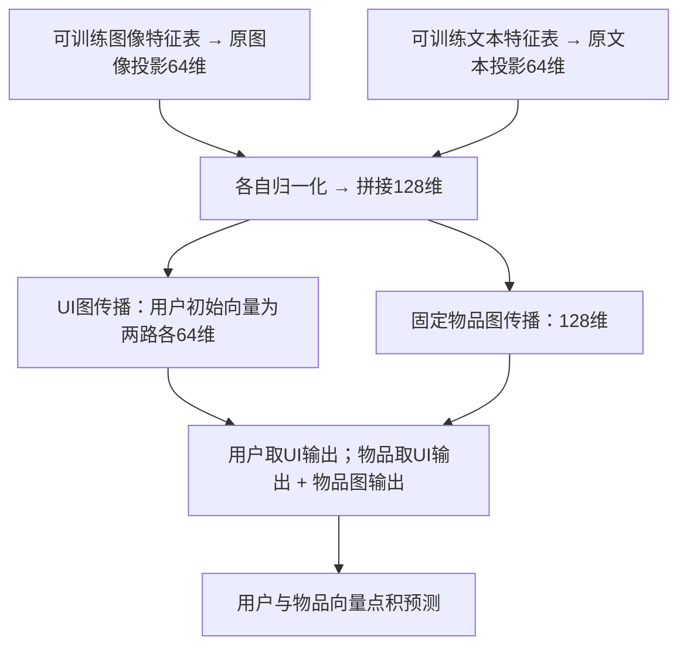
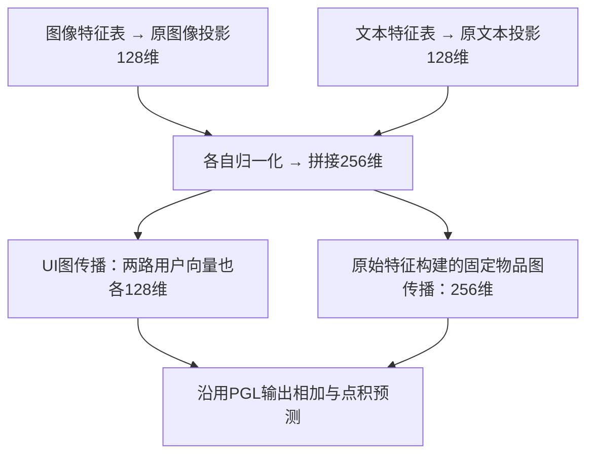
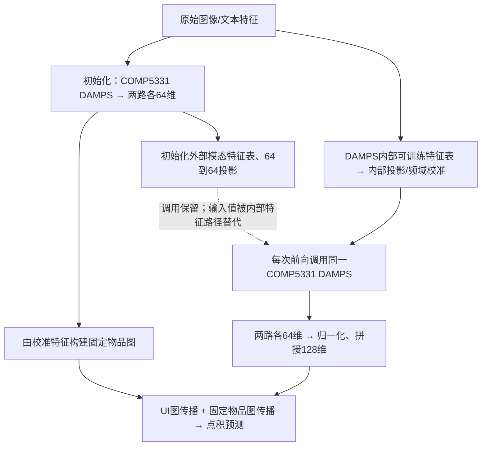
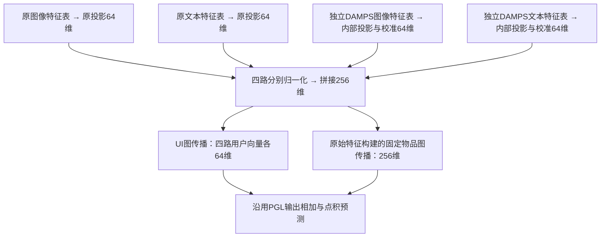

# PGL 与 PGL+DAMPS 五数据集三种子结果

当前官方接入对照统一使用 **COMP5331现有DAMPS＋官方接入流程**，即
`damps_enabled=true, damps_mode=official`。结果来自新批次，未完成处显示进度；
此前官方算子的实验成绩已从本报告移除，不混入新版本。

实验批次：`five-dataset-concat-20261031T103528Z`。原始基线与四路拼接固定种子999、2024、2025的 **30/30** 组已完成；加宽及官方接入补充结果见下表。
五种子实验继续运行；额外种子及五种子汇总仅保留在本地 runs，不纳入本目录或本次提交。

## 四种设计与融合流程

本节说明四种设计；下方成绩表覆盖四种方法和五个数据集，逐行标明完成数及状态，未完成或未安排不填成绩。
`I` 为物品数、`U` 为用户数；图中维度均为单个用户或物品的向量宽度。
“原投影”指骨干原有的图像/文本投影；“DAMPS内部投影”是另一套参数。

| 设计 | 图像/文本投影输出 | 拼接通道 | 最终宽度 | 固定物品图来源 |
|---|---|---:|---:|---|
| 原始 PGL | 各64维 | 2 | 128 | 原始特征 |
| 加宽 PGL | 各128维 | 2 | 256 | 原始特征 |
| 官方流程＋COMP5331 DAMPS | DAMPS各64维 | 2 | 128 | 初始化COMP5331 DAMPS校准特征 |
| 四路拼接 PGL+DAMPS | 原投影各64维，DAMPS各64维 | 4 | 256 | 原始特征 |

### 1. 原始 PGL：两路拼接

UI图传播包含第0层并取各层均值。物品图由原始图文特征构建，再按原PGL权重融合。

### 2. 加宽 PGL：原有两路变宽，不增加projector数量

配置为 `embedding_dim=128, damps_enabled=false`。仍只有原生图像、文本两个投影，其他图传播和融合规则沿用基线。

### 3. 官方接入流程＋COMP5331 DAMPS

DAMPS参与推荐训练；外部PGL模态表/投影没有有效梯度。与主方式复用同一 `nn/damps.py`，
初始化也固定输出D维，不使用独立官方算子或原始宽度重建。当前配置为 `damps_mode=official`。

### 4. 四路拼接 PGL+DAMPS：保留两套独立表征

顺序为 `[原图像, 原文本, DAMPS图像, DAMPS文本]`。两套特征表及投影联合训练；当前入口为 `pgl`、`damps_enabled=true`。它与加宽基线最终同为256维，但分支数量、参数量和计算路径不同。

**接入对照范围：**仅参考官方调用位置/分支流程，统一复用COMP5331的DAMPS。
初始化输出固定D维，而官方发布算子初始化时可重建到原始特征宽度，故不能称为逐字节官方实现。
组件开关沿用COMP5331实现，默认全部开启。旧算子成绩不展示，当前变体仅记录新批次；
未完成不填测试成绩，原基线和四路拼接结果保持原样。

## 四种方法三种子结果（999、2024、2025）

结果更新：**2026-11-03T02:52:12+08:00**（香港时间）。全部固定取seed999、2024、2025，不按成绩挑选种子。
原基线与四路拼接来自原五数据集批次；加宽基线、官方接入来自后续独立对照批次。它们不是同一次训练或同一套融合代码，配置来源见 `four-methods-runs.json`。
数值为已完成种子的测试集均值 ± 样本标准差（n−1）；**仅3/3为完整三种子结果**。部分结果随完成自动更新，未完成不补零。Electronics、MicroLens未安排加宽/官方接入实验，不新增训练。

| 数据集 | 方法 | 完成数 | 状态 | R@10 | R@20 | NDCG@10 | NDCG@20 |
|---|---|---:|---|---:|---:|---:|---:|
| Baby | 原始基线 | 3/3 | 完成 | 0.061783 ± 0.000960 | 0.096876 ± 0.001080 | 0.033457 ± 0.000825 | 0.042455 ± 0.000728 |
| Baby | 加宽基线256维 | 3/3 | 完成 | 0.063728 ± 0.000699 | 0.100636 ± 0.000781 | 0.034509 ± 0.000548 | 0.043955 ± 0.000588 |
| Baby | 官方流程＋COMP5331 DAMPS | 3/3 | 完成 | 0.054567 ± 0.003165 | 0.085134 ± 0.004425 | 0.029247 ± 0.002055 | 0.037097 ± 0.002349 |
| Baby | 四路拼接DAMPS | 3/3 | 完成 | 0.061791 ± 0.000744 | 0.096372 ± 0.001333 | 0.033081 ± 0.000403 | 0.041959 ± 0.000542 |
| Sports | 原始基线 | 3/3 | 完成 | 0.067597 ± 0.001339 | 0.104278 ± 0.002658 | 0.036642 ± 0.000569 | 0.046093 ± 0.000920 |
| Sports | 加宽基线256维 | 3/3 | 完成 | 0.071531 ± 0.001882 | 0.108681 ± 0.001351 | 0.038525 ± 0.000984 | 0.048105 ± 0.000835 |
| Sports | 官方流程＋COMP5331 DAMPS | 3/3 | 完成 | 0.065001 ± 0.001641 | 0.099707 ± 0.002552 | 0.034976 ± 0.000758 | 0.043923 ± 0.000944 |
| Sports | 四路拼接DAMPS | 3/3 | 完成 | 0.072120 ± 0.001936 | 0.108526 ± 0.002317 | 0.038824 ± 0.001344 | 0.048209 ± 0.001417 |
| Clothing | 原始基线 | 3/3 | 完成 | 0.055789 ± 0.001203 | 0.083923 ± 0.001524 | 0.029964 ± 0.000648 | 0.037096 ± 0.000704 |
| Clothing | 加宽基线256维 | 3/3 | 完成 | 0.058298 ± 0.001790 | 0.086221 ± 0.002330 | 0.031176 ± 0.001209 | 0.038263 ± 0.001348 |
| Clothing | 官方流程＋COMP5331 DAMPS | 3/3 | 完成 | 0.042179 ± 0.002397 | 0.065113 ± 0.003576 | 0.022629 ± 0.001635 | 0.028445 ± 0.001938 |
| Clothing | 四路拼接DAMPS | 3/3 | 完成 | 0.057960 ± 0.000708 | 0.086542 ± 0.002532 | 0.031120 ± 0.000407 | 0.038371 ± 0.000894 |
| Electronics | 原始基线 | 3/3 | 完成 | 0.040650 ± 0.000462 | 0.061188 ± 0.000390 | 0.022640 ± 0.000243 | 0.027941 ± 0.000218 |
| Electronics | 加宽基线256维 | 0/3 | 未安排 | 未安排 | 未安排 | 未安排 | 未安排 |
| Electronics | 官方流程＋COMP5331 DAMPS | 0/3 | 未安排 | 未安排 | 未安排 | 未安排 | 未安排 |
| Electronics | 四路拼接DAMPS | 3/3 | 完成 | 0.042368 ± 0.000476 | 0.063356 ± 0.000667 | 0.023635 ± 0.000321 | 0.029060 ± 0.000314 |
| MicroLens | 原始基线 | 3/3 | 完成 | 0.071992 ± 0.000202 | 0.110899 ± 0.000517 | 0.037317 ± 0.000209 | 0.047331 ± 0.000143 |
| MicroLens | 加宽基线256维 | 0/3 | 未安排 | 未安排 | 未安排 | 未安排 | 未安排 |
| MicroLens | 官方流程＋COMP5331 DAMPS | 0/3 | 未安排 | 未安排 | 未安排 | 未安排 | 未安排 |
| MicroLens | 四路拼接DAMPS | 3/3 | 完成 | 0.074073 ± 0.001010 | 0.112427 ± 0.001519 | 0.038820 ± 0.000624 | 0.048705 ± 0.000746 |

### 相对原基线的变化（仅完整三种子计算）

下面为测试R@20均值相对变化，其他指标均值见上表；不代表统计显著性。

| 数据集 | 加宽基线256维 | 官方流程＋COMP5331 DAMPS | 四路拼接DAMPS |
|---|---:|---:|---:|
| Baby | +3.88% | -12.12% | -0.52% |
| Sports | +4.22% | -4.38% | +4.07% |
| Clothing | +2.74% | -22.41% | +3.12% |
| Electronics | 未安排 | 未安排 | +3.54% |
| MicroLens | 未安排 | 未安排 | +1.38% |

四种方法的逐种子结果及有效配置：[four-methods-runs.json](four-methods-runs.json)；完整汇总：[four-methods-summary.csv](four-methods-summary.csv)、[four-methods-summary.json](four-methods-summary.json)。
原有 `runs.json`、`summary.*` 和 `damps-gains.csv` 保留原基线/四路拼接的30组固定三种子记录。所有输出文件均不包含seed2026、2027的成绩。

## 实现与训练协议

- 本目录仅报告固定三个种子 999、2024、2025；原基线与四路拼接30组已完成，补充对照完成情况见上表。五种子实验继续执行，完整结果仅保留本地 runs，不随本目录提交。
- 使用现有数据划分和图文特征；不使用 MicroLens 视频特征。数据内容指纹及划分统计见 `data-fingerprints.json`。
- 各方法固定配置，无逐数据集超参数搜索；加宽基线显式改变embedding_dim，官方适配路径与主方式分开记录。最多1000轮，每轮验证；验证R@20连续20轮无提升早停，选验证最佳checkpoint后评估测试集。
- 全物品排名、过滤训练历史、按用户宏平均、同分按物品ID升序；具体配置和评估协议见 `runs.json`。
- 主方式的DAMPS实现未修改。四路为原图像、原文本、DAMPS图像、DAMPS文本，各64维。
- PGL四路分别归一化后拼接256维，配套四路用户嵌入，再做UI图与物品图传播；物品图由原始特征固定构建。基线最终128维，图文特征表和投影均可训练。
- 拼接增加维度与参数量，因此不能把结果变化单独归因于DAMPS校准，也不将本结果称为论文原始接入方式的严格复现。
- 训练时模型名为 `pgl` / `pgl_damps_concat`，使用冻结源码快照。当前代码已合并为 `pgl`，通过 `damps_enabled` 切换；布局整理未改变既有实验结果。

## 结果文件

| 文件 | 内容 |
|---|---|
| [four-methods-runs.json](four-methods-runs.json) | 四种方法、五数据集、固定三个种子的逐次结果/配置及未安排占位 |
| [four-methods-summary.csv](four-methods-summary.csv)、[four-methods-summary.json](four-methods-summary.json) | 四种方法的完成数、均值、样本标准差和状态 |
| [runs.json](runs.json) | 全部30个三种子组合、状态、每种子最佳轮次/验证指标/测试指标和实际配置；不含机器路径 |
| [summary.json](summary.json)、[summary.csv](summary.csv) | 分数据集、方法和指标的均值/样本标准差/完成数 |
| [damps-gains.csv](damps-gains.csv) | 四项指标的绝对与相对变化；未完成不计算 |
| [training-protocol.json](training-protocol.json) | 固定种子、训练选择规则、维度与融合说明 |
| [data-fingerprints.json](data-fingerprints.json) | 加载后数据指纹、用户物品数量、三种划分统计 |
| [export-provenance.json](export-provenance.json) | 原批次、导出时间、来源摘要和训练源码哈希 |

不提交原始数据、checkpoint、逐轮日志、缓存或依赖环境。原始产物保留在本地对应 runs 批次。
